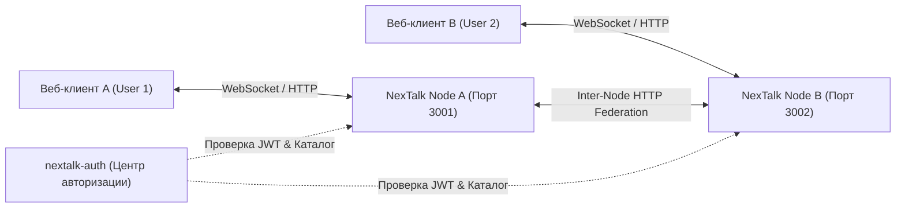

# ⚡ NexTalk WebSocket Node (Серверный узел сети)

> Независимый, высокопроизводительный узел передачи сообщений для децентрализованного мессенджера **NexTalk v3.0**.  
> Построен на базе **Node.js**, **WebSocket (`ws`)** и встроенной **SQLite (WAL)** без необходимости установки внешних СУБД.

---

## 📌 Содержание

- [Обзор и роль в архитектуре](#-обзор-и-роль-в-архитектуре)
- [Ключевые возможности](#-ключевые-возможности)
- [Технологический стек](#-технологический-стек)
- [Требования к окружению](#-требования-к-окружению)
- [Быстрый старт и запуск](#-быстрый-старт-и-запуск)
  - [Режим Zero-Install (Портативный Node.js)](#режим-zero-install-портативный-nodejs)
  - [Стандартный запуск через системный Node.js](#стандартный-запуск-через-системный-nodejs)
  - [Запуск нескольких узлов на одной машине](#запуск-нескольких-узлов-на-одной-машине)
- [Конфигурация окружения (.env)](#-конфигурация-окружения-env)
- [Межузловая федерация (Inter-Node Protocol)](#-межузловая-федерация-inter-node-protocol)
- [Схема базы данных (SQLite)](#-схема-базы-данных-sqlite)
- [API Справочник](#-api-справочник)
  - [HTTP REST Endpoints](#http-rest-endpoints)
  - [WebSocket Protocol & События](#websocket-protocol--события)
- [Безопасность и проверка JWT](#-безопасность-и-проверка-jwt)
- [Публичный доступ (LocalTunnel) и SSL/TLS](#-публичный-доступ-localtunnel-и-ssltls)
- [Служебные скрипты](#-служебные-скрипты)
- [Структура проекта](#-структура-проекта)
- [Устранение неполадок (FAQ)](#-устранение-неполадок-faq)

---

## 🌐 Обзор и роль в архитектуре

Узел **NexTalk Node** является ключевым элементом децентрализованной инфраструктуры. Он отвечает за:



- **Хранение локальной истории**: Сообщения и метаданные комнат сохраняются в локальной SQLite базе данных в зашифрованном E2EE виде.
- **WebSocket-трансляция**: Мгновенный обмен сообщениями, рассылка статусов набора текста и отметок о прочтении внутри комнат.
- **Федерация между узлами**: Автоматическая ретрансляция сообщений пользователям, находящимся на других узлах сети.
- **Автономность**: Узел не зависит от MySQL или центрального сервера для доставки сообщений внутри подключенных клиентов.

---

## ✨ Ключевые возможности

- 🚀 **Zero-Install (Портативный запуск)**:
  - Автоматическая загрузка автономного дистрибутива Node.js в папку `.node/`.
  - Возможность запуска на чистой Windows-машине без прав администратора и без установленного в систему Node.js.
- 💾 **Встроенная SQLite база данных (node:sqlite)**:
  - Использует высокопроизводительный движок `node:sqlite` (`DatabaseSync`).
  - Режим **WAL (Write-Ahead Logging)** и `PRAGMA synchronous = NORMAL` для максимальной скорости записи и устойчивости к сбоям.
  - Автоматическое создание таблиц и миграция при первом запуске.
- 🛡 **Криптографическая верификация JWT**:
  - Валидация подписи JWT-токенов публичным ключом центра авторизации (`public.pem` / RS256/ECDSA).
  - Узел знает только `user_id` и `username`, не имея доступа к паролям пользователей.
- 🔄 **Межузловой протокол федерации (Inter-Node Relay)**:
  - Поддержка сквозных чатов (`global_chat_id`).
  - Сохранение сообщений перед отправкой на удаленный пир (гарантия отсутствия потерь при сбое сети).
  - Разрешение адресов узлов через центральный реестр с локальным кэшированием (TTL).
- 🌐 **Встроенный LocalTunnel**:
  - Быстрый проброс узла в глобальный интернет по защищенному адресу `https://<субдомен>.loca.lt` без белого IP и проброса портов на роутере.
- 🔒 **Поддержка SSL/WSS**:
  - Автоматическое обнаружение SSL-сертификатов OpenServer Panel или кастомных сертификатов для безопасного WebSocket (`wss://`).

---

## 🛠 Технологический стек

- **Среда выполнения**: Node.js v20.10+ / v22+ (требуется поддержка `node:sqlite`)
- **WebSocket**: Библиотека `ws` (v8.18+)
- **База данных**: Встроенный модуль `node:sqlite` (SQLite 3 с WAL-журналированием)
- **Конфигурация**: `dotenv`
- **Туннелирование**: `localtunnel`

---

## 📋 Требования к окружению

- **ОС**: Windows 10/11 / Windows Server / Linux / macOS.
- **Node.js**: Версия 20.10+ или 22+ (если используется системный Node.js).
- Либо **PowerShell 5.1+** (для автоматической загрузки портативного Node.js на Windows).

---

## 🚀 Быстрый старт и запуск

### Режим Zero-Install (Портативный Node.js)

Если на машине не установлен Node.js, узел может скачать и использовать изолированную портативную версию:

1. Перейдите в каталог `nextalk-node`.
2. Создайте конфигурационный файл `.env`:
   ```cmd
   copy .env.example .env
   ```
3. Запустите скрипт:
   ```cmd
   start.bat
   ```
   *Скрипт автоматически скачает официальный портативный Node.js v22 в подпапку `.node`, подготовит окружение и запустит сервер.*

---

### Стандартный запуск через системный Node.js

Если в системе уже установлен Node.js 22+:

1. Установите зависимости:
   ```bash
   npm install
   ```
2. Скопируйте публичный ключ авторизации из `nextalk-auth`:
   ```bash
   node scripts/sync-jwt-public-key.js
   ```
3. Запустите сервер:
   ```bash
   npm start
   # Или в режиме разработки с указанием порта:
   npm run dev
   ```

---

### Запуск нескольких узлов на одной машине

Для тестирования межузловой федерации можно поднять два независимых узла на разных портах:

```cmd
:: Запуск Узла 1 на порту 3001 (Node ID = 3001):
start.bat 3001

:: В отдельном терминале — запуск Узла 2 на порту 3002:
start.bat 3002
```

---

## ⚙ Конфигурация окружения (.env)

Пример файла `.env`:

```ini
# Основные параметры узла
PORT=3001
NODE_NAME="NexTalk Primary Node"
NODE_ID=3001

# Режим портативного Node.js (true — автономная папка .node, false — системный PATH)
USE_LOCAL_NODE=true
LOCAL_NODE_DIR=".node"
NODE_VERSION="v22.13.0"

# Интеграция с центром авторизации
AUTH_URL="http://nextalk-auth"
AUTH_REGISTRY_URL="http://nextalk-auth/nodes"
JWT_ISSUER="nextalk-auth"
JWT_TTL=604800

# Путь к базе данных SQLite (создается автоматически)
DB_PATH="./data/nextalk.db"

# Публичный доступ через LocalTunnel
LOCALTUNNEL_ENABLED=false
LOCALTUNNEL_SUBDOMAIN="my-nextalk-node"

# Межузловой таймаут ретрансляции (мс)
INTER_NODE_RELAY_TIMEOUT_MS=3000
```

---

## 🔄 Межузловая федерация (Inter-Node Protocol)

Узлы NexTalk поддерживают распределенную доставку сообщений:

1. **Создание кросс-нодового чата**:
   - При создании чата между пользователями разных узлов генерируется общий UUID `global_chat_id`.
   - В локальной базе сохраняется привязка к пиру: `peer_url` и `peer_node_id`.
2. **Отправка сообщения**:
   - Клиент отправляет сообщение на свой узел (`POST /api/nodes/inter-node/send` или через WebSocket).
   - Локальный узел сохраняет сообщение в свою SQLite базу (гарантируя сохранность автору).
   - Выполняется вызов `POST /api/nodes/inter-node/inbound` на удалённый узел-партнёр.
   - Удалённый узел сохраняет сообщение у себя и рассылает подключенным клиентам через WebSocket.

---

## 💾 Схема базы данных (SQLite)

База данных хранится в файле `data/nextalk.db` и инициализируется модулем [src/database.js](file:///d:/OSPanel/domains/nextalk-node/src/database.js):

- `chats`: `id`, `type` (private/group/channel), `name`, `global_chat_id`, `origin_node_id`, `created_at`.
- `chat_members`: `id`, `chat_id`, `user_id`, `username`, `last_read_message_id`.
- `messages`: `id`, `chat_id`, `sender_id`, `username`, `content` (E2EE шифротекст), `global_message_id`, `created_at`.
- `chat_node_peers`: Сопоставление локальных чатов с удаленными пир-узлами (`chat_id`, `peer_url`, `peer_node_id`).
- `nodes_cache`: Локальный кэш реестра известных узлов сети.

---

## 📡 API Справочник

### HTTP REST Endpoints

Сервер слушает на едином порту (по умолчанию `3001`):

#### 1. Мониторинг и статус
- `GET /health` или `GET /api/health`  
  Возвращает метрики узла: статус онлайна, количество активных WebSocket-подключений, комнат, сообщений, аптайм и версию.

#### 2. Чаты и сообщения (требуют `Authorization: Bearer <JWT>`)
- `GET /api/chats` — Список чатов текущего пользователя с непрочитанными счетчиками.
- `POST /api/chats` — Создание нового диалога или группы.
- `GET /api/chats/:id/messages` — История сообщений чата (с поддержкой пагинации).
- `POST /api/messages` — Отправка сообщения в чат.
- `POST /api/messages/read` — Обновление статуса прочтения сообщений.

#### 3. Межузловой протокол (Inter-Node)
- `POST /api/nodes/inter-node/send` — Инициация ретрансляции исходящего сообщения.
- `POST /api/nodes/inter-node/inbound` — Приём входящего сообщения от удалённого узла.
- `POST /api/nodes/inter-node/chats` — Создание/связывание кросс-нодового диалога.
- `GET /api/nodes/inter-node/sync` — Синхронизация пропущенных сообщений между пирами.

---

### WebSocket Protocol & События

Подключение осуществляется по адресу `ws://localhost:3001` (или `wss://...`):

#### Аутентификация:
Сразу после открытия соединения клиент обязан отправить пакет аутентификации:
```json
{
  "type": "auth",
  "token": "<JWT_ACCESS_TOKEN>"
}
```
*В ответ сервер присылает `{"type": "auth_ok", "user_id": 1, "username": "alice"}`.*

#### Основные события:
- `message`: Передача и получение нового зашифрованного сообщения.
- `typing`: Уведомление о наборе текста (`{ "type": "typing", "chat_id": 12 }`).
- `read`: Отметка о прочтении сообщений.
- `ping` / `pong`: Поддержание соединения (heartbeat).

---

## 🔐 Безопасность и проверка JWT

- Узел проверяет JWT с помощью стандартного асимметричного открытого ключа `public.pem`.
- Проверяются обязательные клеймы:
  - `iss`: равен значению `JWT_ISSUER` (по умолчанию `nextalk-auth`).
  - `exp`: срок жизни токена не истёк.
  - `sub` / `user_id`: идентификатор пользователя.
- Если публичный ключ обновился на сервере авторизации, запустите:
  ```bash
  node scripts/sync-jwt-public-key.js
  ```

---

## 🌍 Публичный доступ (LocalTunnel) и SSL/TLS

### Запуск с LocalTunnel:
Установите в `.env`:
```ini
LOCALTUNNEL_ENABLED=true
LOCALTUNNEL_SUBDOMAIN="my-public-node"
```
Сервер автоматически поднимет туннель и выведет в лог публичный URL:
`https://my-public-node.loca.lt` и `wss://my-public-node.loca.lt`.

### Использование SSL OpenServer:
Узел автоматически проверяет стандартный путь сертификатов OpenServer Panel:
`C:/OSPanel/userdata/config/cert_files/server.crt`. При их наличии автоматически запускается HTTPS/WSS сервер.

---

## 🛠 Служебные скрипты

В папке `scripts/` находятся полезные утилиты:

| Скрипт | Описание |
| :--- | :--- |
| `setup-local-node.ps1` | Автоматическая загрузка портативного Node.js в папку `.node` |
| `sync-jwt-public-key.js` | Загрузка актуального `public.pem` из папки `nextalk-auth` |
| `generate-jwt-keys.js` | Генерация новой криптографической пары ключей RS256 |
| `inter-node-e2e.js` | Сквозной E2E-тест доставки сообщений между двумя узлами |
| `jwt-sign-test.js` | Тест корректности подписи и верификации токенов |

---

## 📁 Структура проекта

```text
nextalk-node/
├── data/                            # Автоматически создаваемая директория SQLite
│   └── nextalk.db                   # База данных SQLite с журналом WAL
├── scripts/                         # Автоматизация и тестирование
│   ├── generate-jwt-keys.js         # Генератор RSA-ключей
│   ├── inter-node-e2e.js            # Тестирование межузловой связи
│   ├── jwt-sign-test.js             # Проверка подписи JWT
│   ├── setup-local-node.bat         # CMD-обёртка для загрузки Node.js
│   ├── setup-local-node.ps1         # PowerShell загрузчик портативного Node.js
│   ├── setup-local-node.sh          # Скрипт подготовки для Linux
│   └── sync-jwt-public-key.js       # Синхронизация открытого ключа авторизации
├── src/                             # Исходный код модулей узла
│   ├── http/                        # HTTP сервер и маршрутизация
│   │   ├── helpers.js               # CORS, парсинг JSON, отправка ответов
│   │   ├── proxy.js                 # Проксирование запросов к другим узлам
│   │   └── router.js                # Главный HTTP-роутер API
│   ├── routes/                      # Маршруты API
│   │   ├── auth.js                  # Валидация токенов и аутентификация
│   │   ├── chats.js                 # Управление чатами и комнатами
│   │   ├── inter-node.js            # Федеративный протокол обмена между узлами
│   │   ├── messages.js              # Отправка и получение сообщений
│   │   └── users.js                 # Поиск пользователей и статусы
│   ├── ws/                          # Подсистема WebSocket
│   │   ├── handlers.js              # Обработчики сообщений и событий WS
│   │   ├── index.js                 # Инициализация WSS и heartbeat
│   │   └── state.js                 # Состояние активных клиентов, комнат и счетчиков
│   ├── config.js                    # Параметры конфигурации узла
│   ├── database.js                  # Инициализация SQLite, миграции и Prepared Statements
│   ├── jwt.js                       # Верификация JWT-токенов
│   ├── logger.js                    # Логирование событий с метками времени
│   └── nodes.js                     # Взаимодействие с реестром и пир-узлами
├── .env.example                     # Пример файла переменных окружения
├── package.json                     # Манифест зависимостей npm
├── public.pem                       # Открытый ключ JWT для верификации клиентов
├── server.js                        # Точка входа приложения
├── start.bat                        # Скрипт запуска узла для Windows
└── start.sh                         # Скрипт запуска узла для Linux/macOS
```

---

## ❓ Устранение неполадок (FAQ)

### 1. Ошибка «node:sqlite is not available»
- Для работы встроенной SQLite требуется **Node.js версии 22** (или 20.10+ с экспериментальными флагами).
- Запустите скрипт `start.bat --setup-node`, чтобы автоматически скачать готовую портативную версию Node.js v22 в папку `.node`.

### 2. Ошибка «JWT verification failed: invalid signature»
- Проверьте, совпадает ли файл `public.pem` в папке узла с публичным ключом сервера авторизации (`nextalk-auth`).
- Выполните синхронизацию командой: `node scripts/sync-jwt-public-key.js`.

### 3. Ошибка занятого порта (EADDRINUSE: 3001)
- Порт 3001 уже используется другим процессом.
- Вы можете запустить узел на любом свободном порту, передав его аргументом: `start.bat 3005` или указав `PORT=3005` в файле `.env`.

---

## 📄 Лицензия

Проект распространяется под лицензией **MIT**.
